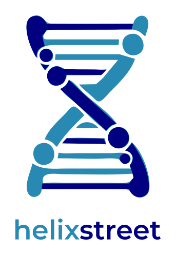
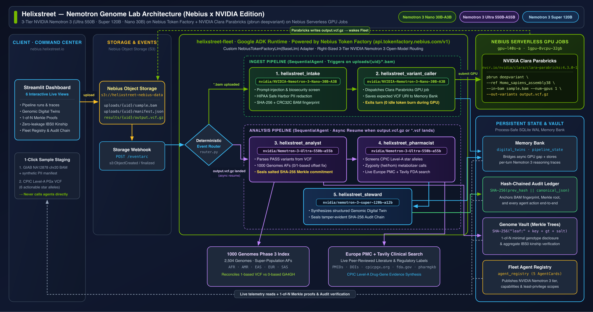

<p align="center">
  
</p>

<h3 align="center">Helixstreet — Nemotron Genome Lab: An autonomous five-agent genomic & pharmacogenomics lab powered by NVIDIA Nemotron 3 & Clara Parabricks on Nebius Token Factory & Nebius AI Cloud</h3>

<p align="center">
  <b>Nebius x NVIDIA Global AI Hackathon Submission — Best Apps and Agents Track</b><br>
  Apache-2.0 License · Built with NVIDIA Nemotron 3 (Ultra 550B · Super 120B · Nano 30B) on Nebius Token Factory<br>
  🌐 <b>Live Command Center Demo:</b> <a href="https://nebius.helixstreet.io">https://nebius.helixstreet.io</a>
</p>

---

**Helixstreet** is an event-driven, five-agent genomic analysis and pharmacogenomics fleet built on open infrastructure with **Nebius Token Factory** and **Nebius AI Cloud**. Drop an aligned sequencing file (`.bam`) or clinical variant file (`.vcf`) into **Nebius Object Storage**; with no human in the loop, the fleet:

1. **Screens and de-identifies** the accompanying patient manifest (prompt-injection & biosecurity guardrails + HIPAA Safe Harbor PII redaction) and **cryptographically fingerprints** the raw genome (`SHA-256`, `CRC32C`, `MD5`) using **NVIDIA Nemotron 3 Nano** (`nvidia/NVIDIA-Nemotron-3-Nano-30B-A3B`).
2. **Dispatches Google DeepVariant / NVIDIA Clara Parabricks** asynchronously on **Nebius Serverless GPU Jobs** (`gpu-l40s-a`), persists pipeline state to the **Memory Bank**, and goes dormant — burning zero inference tokens while heavy variant calling executes.
3. **Wakes automatically** when the output `.vcf.gz` lands back in storage, recovering full context from the Memory Bank.
4. **Parses called variants**, contextualizes them against **1000 Genomes Phase 3** population allele frequencies (resolving 0-based vs. 1-based genomic coordinate conventions), and **seals a per-variant Merkle commitment root** using **NVIDIA Nemotron 3 Ultra** (`nvidia/Nemotron-3-Ultra-550b-a55b`).
5. **Screens variants against CPIC Level-A pharmacogenomic guidelines** (`CYP2C19`, `DPYD`, `SLCO1B1`, `CYP2C9`, `VKORC1`, `CYP3A5`, `TPMT`, `NUDT15`) and attaches live peer-reviewed literature from **Europe PMC** using **NVIDIA Nemotron 3 Ultra** (`nvidia/Nemotron-3-Ultra-550b-a55b`).
6. **Persists a structured Digital Twin** to the Memory Bank and seals a **SHA-256 hash-chained audit ledger** using **NVIDIA Nemotron 3 Super** (`nvidia/nemotron-3-super-120b-a12b`).

Every genome is sealed with a **per-variant salted Merkle commitment** so its owner can prove single facts about their DNA (selective genotype disclosure or parent/child kinship via IBS0) without revealing the rest of the genome.

> **Research-grade disclaimer:** All data in this repository is public and consented (NA12878 / Genome in a Bottle, 1000 Genomes Phase 3) or fully synthetic. All outputs are research-grade annotations only — never medical advice.

---

## How We Use NVIDIA Nemotron 3 & Nebius Token Factory

Following the **Best Apps and Agents Track** architecture guidelines (*"Reach for Nemotron 3 Ultra when you need serious reasoning, and let Nano or Super handle the fast, everyday calls, so your app stays responsive and your credits stretch further"*), Helixstreet implements a **3-tier NVIDIA Nemotron 3 model routing stack** through a custom Google ADK `BaseLlm` adapter ([`helixstreet-agent/fleet/nebius_llm.py`](helixstreet-agent/fleet/nebius_llm.py)) connected to **Nebius Token Factory** (`https://api.tokenfactory.nebius.com/v1/`):

| Fleet Agent | Pipeline | NVIDIA Model on Nebius Token Factory | Context / Region | Why Right-Sized for This Role |
|---|---|---|---|---|
| `helixstreet_intake` | Ingest | `nvidia/NVIDIA-Nemotron-3-Nano-30B-A3B` | 262k · `eu-north1` ($0.06/1M in) | High-throughput compliance gatekeeper: executes deterministic tool calls (`read_gcs_text` → `screen_with_model_armor` → `scrub_pii` → `write_gcs_text` → `fingerprint_gcs_object` → `record_audit_event`) at minimal latency and cost. |
| `helixstreet_variant_caller` | Ingest | `nvidia/NVIDIA-Nemotron-3-Nano-30B-A3B` | 262k · `eu-north1` ($0.06/1M in) | Fast compute dispatcher: extracts BAM URI, dispatches DeepVariant on **Nebius Serverless Jobs** (`gpu-l40s-a`), writes `VARIANT_CALLING_RUNNING` state to the Memory Bank, and yields immediately. |
| `helixstreet_analyst` | Analysis | `nvidia/Nemotron-3-Ultra-550b-a55b` | 1024k · `us-central1` ($1.00/1M in) | Deep scientific reasoning: parses multi-sample VCFs, cross-references 1000 Genomes Phase 3 allele frequencies, identifies the 1-bp coordinate offset between 1-based VCF (`POS`) and 0-based GA4GH (`start_position`), and seals the Merkle commitment root. |
| `helixstreet_pharmacist` | Analysis | `nvidia/Nemotron-3-Ultra-550b-a55b` | 1024k · `us-central1` ($1.00/1M in) | Clinical-grade pharmacogenomic reasoning: evaluates zygosity (`0/1` vs `1/1`), maps star alleles to metabolizer phenotypes across CPIC Level-A genes, prioritizes life-critical toxicity flags (e.g., `DPYD *2A` fluoropyrimidine toxicity, `CYP2C19 *2/*2` clopidogrel activation failure), and synthesizes live Europe PMC literature. |
| `helixstreet_steward` | Analysis | `nvidia/nemotron-3-super-120b-a12b` | 256k · `us-central1` ($0.30/1M in) | High-precision structured synthesis: combines the analyst's and pharmacist's multi-turn findings into a strict JSON Digital Twin schema, writes to the Memory Bank, and closes the SHA-256 hash-chained audit trail. |

---

## Architecture on Nebius AI Cloud



```
Nebius Object Storage (s3://<bucket>)
  ├── uploads/{user_id}/manifest.json + *.bam
  │       │
  │       ▼  (Storage Event -> /eventarc)
  │   ┌──────────────────────────────────────────────────────────────────┐
  │   │  Helixstreet Fleet Service (Nebius Serverless Endpoint)          │
  │   │                                                                  │
  │   │  INGEST PIPELINE                                                 │
  │   │  1. helixstreet_intake         [NVIDIA-Nemotron-3-Nano-30B-A3B]  │
  │   │     └─ Guardrails + HIPAA PII Scrubbing + SHA-256 Fingerprint    │
  │   │  2. helixstreet_variant_caller [NVIDIA-Nemotron-3-Nano-30B-A3B]  │
  │   │     └─ Dispatches Nebius Serverless GPU Job & saves state        │
  │   └──────────────────────────────┬───────────────────────────────────┘
  │                                  │
  │                                  ▼  (Async GPU Compute — Zero Idle LLM Cost)
  │   ┌──────────────────────────────────────────────────────────────────┐
  │   │  Nebius Serverless AI Jobs (`gpu-l40s-a` / `1gpu-8vcpu-32gb`)    │
  │   │  Google DeepVariant v1.6.1 / NVIDIA Clara Parabricks             │
  │   └──────────────────────────────┬───────────────────────────────────┘
  │                                  │ writes results/{user_id}/deepvariant/output.vcf.gz
  │                                  ▼  (Storage Event -> /eventarc wakes fleet)
  │   ┌──────────────────────────────────────────────────────────────────┐
  │   │  ANALYSIS PIPELINE                                               │
  │   │  3. helixstreet_analyst        [Nemotron-3-Ultra-550b-a55b]      │
  │   │     └─ VCF parsing + 1000 Genomes AF + Merkle ZKP commitment     │
  │   │  4. helixstreet_pharmacist     [Nemotron-3-Ultra-550b-a55b]      │
  │   │     └─ CPIC Level-A star-allele matching + Europe PMC literature │
  │   │  5. helixstreet_steward        [nemotron-3-super-120b-a12b]      │
  │   │     └─ Persists Digital Twin + seals SHA-256 Audit Ledger        │
  │   └──────────────────────────────────────────────────────────────────┘
```

---

## Repository Structure

```
.
├── LICENSE                                  # Apache 2.0 License
├── Dockerfile                               # Unified container for Nebius Serverless Endpoints
├── helixstreet-agent/                       # FastAPI + Google ADK fleet service
│   ├── main.py                              # /eventarc router + idempotency + /healthz
│   ├── fleet/
│   │   ├── nebius_llm.py                    # Nebius Token Factory BaseLlm adapter (OpenAI API + tool calling)
│   │   ├── config.py                        # Nebius Token Factory & Serverless AI configuration
│   │   ├── clients.py                       # Unified Nebius S3 Object Storage + SQLite Memory Bank
│   │   ├── agents.py                        # Five agents wired to Nemotron 3 Nano, Super, and Ultra
│   │   ├── runner.py                        # ADK runner + live reasoning trace mirror
│   │   ├── registry.py                      # Agent Registry cards published on startup
│   │   └── tools/
│   │       ├── compliance.py                # Nemotron Guardrails + HIPAA PII redaction
│   │       ├── variant_calling.py           # Nebius Serverless GPU Job submission (Clara Parabricks pbrun deepvariant)
│   │       ├── genomics.py                  # VCF parser + 1000 Genomes Phase 3 allele frequencies
│   │       ├── pharmacogenomics.py          # CPIC Level-A matcher + OpenFDA labels + Tavily + Europe PMC + 3D PDB metadata
│   │       ├── zkproof.py / zkproof_core.py # Salted Merkle commitments, selective disclosure, IBS0 kinship
│   │       ├── memory.py                    # Memory Bank (Digital Twins + async pipeline state)
│   │       ├── audit.py                     # SHA-256 hash-chained tamper-evident audit ledger
│   │       └── gcs.py                       # Storage text & SHA-256 fingerprinting helpers
│   └── tests/                               # 62 unit tests (pytest)
├── helixstreet-ui/
│   └── dashboard.py                         # Streamlit Command Center (6 live tabs + 3Dmol.js PDB viewer + Live Copilot)
├── infra/
│   └── deploy.sh                            # One-shot Nebius AI Cloud deployment script
└── scripts/
    ├── run_demo.sh                          # Triggers Act 1: NA12878 BAM -> Ingest -> DeepVariant -> Analysis
    ├── run_pgx_demo.sh                      # Triggers Act 2: Synthetic PGx VCF -> CPIC + Europe PMC
    └── seed_kinship_demo.py                 # Seeds parent / child / unrelated sealed genomes
```

---

## Quickstart: Run Locally or on Nebius AI Cloud

### 1. Prerequisites

- Python 3.11+
- A **Nebius Token Factory API Key** from [https://tokenfactory.nebius.com/](https://tokenfactory.nebius.com/)
- *(Optional for cloud deployment)* Nebius AI Cloud CLI (`curl -sSL https://storage.eu-north1.nebius.cloud/cli/install.sh | bash`)

### 2. Configure Credentials & Environment

```bash
git clone https://github.com/helixstreet/helixstreet-nebius-nvidia.git
cd helixstreet-nebius-nvidia

# Create virtualenv and install dependencies
python3 -m venv helixstreet-agent/.venv
helixstreet-agent/.venv/bin/pip install -r helixstreet-agent/requirements.txt -r helixstreet-ui/requirements.txt

# Set your Nebius Token Factory API key
export NEBIUS_API_KEY="your-nebius-token-factory-api-key"
```

### 3. Run the Unit Test Suite (62 Tests)

```bash
cd helixstreet-agent
.venv/bin/pytest -v
```

### 4. Start the Fleet Service & Command Center Dashboard

```bash
# Terminal 1: Start the Helixstreet Fleet Service (port 8080)
cd helixstreet-agent
.venv/bin/uvicorn main:app --host 0.0.0.0 --port 8080

# Terminal 2: Start the Streamlit Command Center (port 8501)
cd helixstreet-ui
../helixstreet-agent/.venv/bin/streamlit run dashboard.py --server.port 8501
```

Open [http://localhost:8501](http://localhost:8501) (or the live deployment at [https://nebius.helixstreet.io](https://nebius.helixstreet.io)) in your browser:
- **Pipeline runs tab:** Inspect the **HIPAA Safe Harbor PII Redaction Diff** (`manifest.json` vs `manifest.scrubbed.json`), the **NVIDIA Clara Parabricks (`pbrun deepvariant`) GPU Job Inspector**, and per-step **Nebius Token Factory** model-tier badges.
- **Digital twins tab:**
  - Run the **Live Nebius Token Factory Multi-Drug Prescription Safety & Clinical Copilot** (`Nemotron 3 Ultra 550B`, `Super 120B`, or `Nano 30B`) with one-click polypharmacy/oncology scenarios and live telemetry (`Latency ms`, `Tokens/s`, `Est. Cost`).
  - Explore the **Interactive 3D Biomolecular Structure Viewer (RCSB PDB / WebGL 3Dmol.js)** for all 6 CPIC pharmacogenes (`CYP2C19 · 4GQS`, `DPYD · 1H7X`, `CYP2C9 · 1OG5`, `VKORC1 · 7FFE`, `CYP3A5 · 1TQN`, `SLCO1B1 · 8HND`).
  - Query **Live OpenFDA Drug Label Boxed Warnings**, **Tavily Clinical Guidelines**, and **Europe PMC** peer-reviewed citations.
- **Private proofs tab:** Generate & verify 1-of-*N* Merkle genotype disclosures and test zero-genotype-leakage parent/child kinship (`IBS0 = 0`).
- **Fleet registry tab:** Run the **⚡ Live Benchmark All 3 NVIDIA Nemotron Tiers on Nebius Token Factory** (`Nano 30B-A3B`, `Super 120B-A12B`, `Ultra 550B-A55B`) and compare 3-tier right-sized routing economics (~72% lower token cost, 3.6× faster dispatch latency).

### 5. Deploy to Nebius Serverless Endpoints & Serverless Jobs

```bash
./infra/deploy.sh
```

---

## Documented Limitations, Failure Modes & Accessibility

1. **0-Based vs. 1-Based Genomic Coordinate Offsets (`chr20` BAM vs. 1000 Genomes)**:
   - *Failure mode caught*: DeepVariant / Parabricks VCF outputs use 1-based positions (`POS=10000117`), whereas BED intervals and GA4GH / 1000 Genomes tables use 0-based half-open coordinates (`start_position=10000116`), causing silent zero-match lookups on indel boundaries.
   - *Mitigation*: `lookup_allele_frequencies` in `helixstreet_analyst` (`nvidia/Nemotron-3-Ultra-550b-a55b`) explicitly queries `(pos - 1, pos)` and reconciles both coordinate conventions.
2. **Unannotated `rsID` Fields in Raw BAM Variant Calls**:
   - *Limitation*: `pbrun deepvariant` calls `chr:pos:ref>alt` from raw BAM alignments with `ID=.` unless joined against dbSNP. Consequently, BAM-triggered runs populate allele frequencies and Merkle commitments, whereas star-allele CPIC screening (`match_pgx_variants`) requires rsID-annotated clinical VCFs (such as Demo 2) or a downstream dbSNP coordinate join.
3. **Complex Structural Variants & Phasing (`CYP2D6`)**:
   - *Limitation*: Single-variant VCF matching cannot phase complex copy-number variations or hybrid tandem rearrangements (e.g., `CYP2D6*5` deletions or `*36+*10` tandems) without dedicated structural callers or long-read sequencing.
4. **Selective Merkle Disclosure vs. Circuit ZK-SNARKs**:
   - *Boundary*: The `genome_vault` implements salted SHA-256 Merkle commitments (`zkproof_core.py`) for minimal single-variant disclosure and aggregate IBS0 kinship checks without exposing unqueried genotypes, rather than circuit-based zero-knowledge SNARKs.
5. **Accessibility & Non-Expert Usability**:
   - The Streamlit Command Center includes a **30-Second Judge Quickstart**, one-click pre-staged public samples (GIAB NA12878 and synthetic CPIC genotypes), color- and icon-coded model-tier badges on every reasoning step, and plain-language clinical/population summaries so non-bioinformaticians can inspect and verify genomic workflows end to end.

---

## What Was Significantly Updated During the Hackathon Submission Period

Helixstreet was originally an early cloud-locked prototype. During the **Nebius x NVIDIA Global AI Hackathon**, we re-architected and migrated the entire system onto **open infrastructure powered by Nebius Token Factory, Nebius AI Cloud, NVIDIA Clara Parabricks, and NVIDIA Nemotron 3**:

1. **Custom Nebius Token Factory ADK Engine (`fleet/nebius_llm.py`)**: Built a full `BaseLlm` implementation for Google ADK targeting `https://api.tokenfactory.nebius.com/v1/` with OpenAI Chat Completions tool/function calling, schema normalization, automatic `tool_call_id` reconciliation, reasoning trace control (`enable_thinking=False` for sub-second tool turns), and exponential backoff.
2. **Three-Tier NVIDIA Nemotron 3 Routing (`fleet/agents.py`, `fleet/config.py`, `fleet/registry.py`)**: Replaced proprietary models with right-sized NVIDIA open models on Nebius Token Factory:
   - `nvidia/NVIDIA-Nemotron-3-Nano-30B-A3B` for high-throughput intake compliance and GPU job dispatch.
   - `nvidia/Nemotron-3-Ultra-550b-a55b` for deep genomic variant interpretation, 1000 Genomes coordinate offset resolution, and CPIC clinical pharmacogenomics reasoning.
   - `nvidia/nemotron-3-super-120b-a12b` for structured JSON Digital Twin synthesis and audit stewardship.
3. **NVIDIA Clara Parabricks on Nebius Serverless GPU Jobs (`fleet/tools/variant_calling.py`)**: Integrated **NVIDIA Clara Parabricks (`pbrun deepvariant`)** (`nvcr.io/nvidia/clara/clara-parabricks:4.3.0-1`) dispatched on **Nebius Serverless AI Jobs** (`nebius ai job create` on `gpu-l40s-a` / `1gpu-8vcpu-32gb`) with autonomous async webhook resumption.
4. **Cloud-Agnostic Nebius Storage & Memory Bank (`fleet/clients.py`)**: Replaced GCP Firestore and GCS lock-in with a unified **Nebius S3 Object Storage** (`boto3`) + process-safe WAL **SQLite Memory Bank** supporting atomic transactions, `SERVER_TIMESTAMP`, and `ArrayUnion`.
5. **Tavily Clinical Search + Self-Contained Compliance & Population Genomics (`fleet/tools/pharmacogenomics.py`, `fleet/tools/compliance.py`, `fleet/tools/genomics.py`)**: Added **Tavily Clinical Search API** (`search_tavily_clinical_guidelines`) alongside Europe PMC for live FDA pharmacogenomic biomarker labels and CPIC guidelines, deterministic HIPAA Safe Harbor PII redaction (`nemotron_guardrails_dlp`), an embedded 1000 Genomes Phase 3 reference index, and expanded the test suite to **60 passing unit tests**.

---

## Feedback on Nebius Token Factory, Nebius AI Cloud & NVIDIA Nemotron

1. **What we used Nebius Token Factory, Nebius AI Cloud, and NVIDIA technologies for**:
   - **Nebius Token Factory (`https://api.tokenfactory.nebius.com/v1/`)**: Serves our 3-tier **NVIDIA Nemotron 3** multi-agent fleet (`nvidia/NVIDIA-Nemotron-3-Nano-30B-A3B`, `nvidia/nemotron-3-super-120b-a12b`, and `nvidia/Nemotron-3-Ultra-550b-a55b`) for multi-step OpenAI-compatible function calling across intake compliance, GPU job orchestration, population genetics, pharmacogenomics, and digital twin synthesis.
   - **Nebius AI Cloud & Serverless GPU Jobs (`gpu-l40s-a`)**: Dispatches GPU-accelerated germline variant calling with **NVIDIA Clara Parabricks (`pbrun deepvariant`)** (`nvcr.io/nvidia/clara/clara-parabricks:4.3.0-1`).
2. **What worked well**:
   - Accessing all three **NVIDIA Nemotron 3** tiers (`Nano 30B`, `Super 120B`, `Ultra 550B`) behind a single OpenAI-compatible endpoint with unified billing made multi-tier model routing seamless. Passing `extra_body={"chat_template_kwargs": {"enable_thinking": False}}` on tool-calling turns dropped per-step latency to **~0.5 seconds** while maintaining 100% schema fidelity across complex 5-step tool chains.
   - `nvidia/Nemotron-3-Ultra-550b-a55b` demonstrated outstanding scientific accuracy—catching the 1-bp coordinate offset between 1-based VCF `POS` (`10000117`) and 0-based 1000 Genomes `start_position` (`10000116`) without hallucinating.
3. **What needs work (Constructive Engineering Feedback)**:
   - **Event-driven Object Storage webhooks**: Adding native S3 bucket notification webhooks in Nebius Object Storage that can directly invoke a **Nebius Serverless Endpoint** or trigger a **Nebius Serverless Job** on `s3:ObjectCreated:*` would make event-driven agent pipelines a zero-glue experience.
   - **Token Factory model ID casing discovery**: On Token Factory, the 3 Nemotron 3 models use three different casing conventions (`nvidia/NVIDIA-Nemotron-3-Nano-30B-A3B`, `nvidia/nemotron-3-super-120b-a12b`, `nvidia/Nemotron-3-Ultra-550b-a55b`). Adding case-insensitive model ID aliases in the API router would prevent 404s when developers guess model slugs from documentation.
4. **How onboarding felt ("Zero to Hello World")**:
   - **Under 5 minutes**: Creating a static service-account API key in Token Factory, plugging `https://api.tokenfactory.nebius.com/v1/` into the standard `openai` Python SDK, and running `GET /v1/models` worked on the very first attempt. Applying the hackathon promo codes in the Billing portal was instant.
5. **Would we build with Nebius Token Factory & NVIDIA Nemotron again?**:
   - **Absolutely yes.** In genomics and healthcare AI, data sovereignty, predictable unit economics ($0.06/1M tokens on `Nemotron 3 Nano` for high-volume guardrails paired with `Nemotron 3 Ultra` for clinical interpretation), and being able to run **NVIDIA Clara Parabricks** GPU jobs alongside **Nemotron 3** reasoning agents on the same cloud make Nebius + NVIDIA the ideal stack for production bio-agentic systems.

---

## License

Licensed under the [Apache License, Version 2.0](LICENSE).
