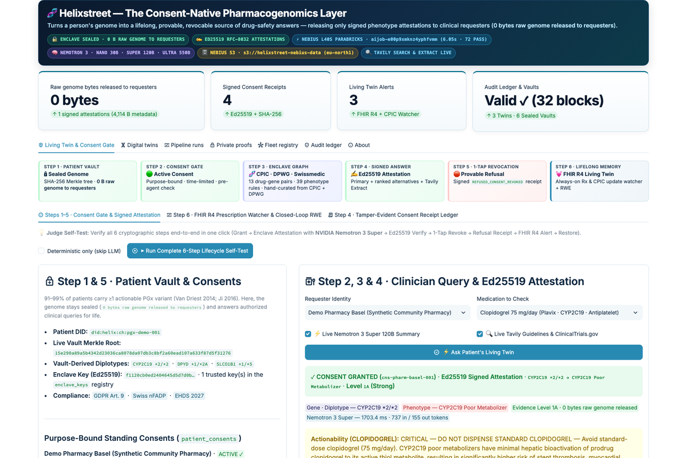
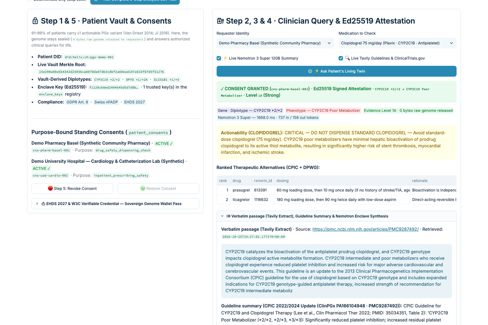
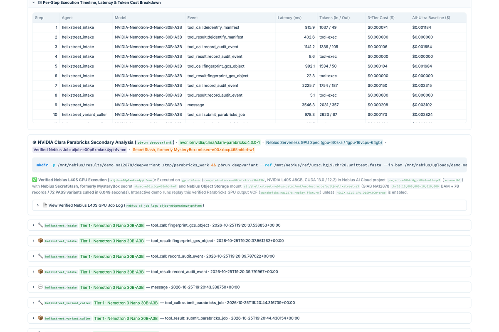
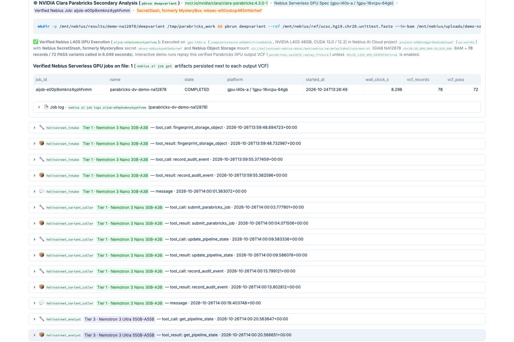

<p align="center">
  
</p>

<h3 align="center">Helixstreet — The Consent-Native Pharmacogenomics Layer</h3>
<p align="center"><i>Turns a person's genome into a lifelong, provable, revocable source of drug-safety answers — with 0 bytes of raw genome released to requesters.</i></p>

<p align="center">
  <b>Nebius x NVIDIA Global AI Hackathon Submission — Best Apps and Agents Track</b><br>
  Apache-2.0 License · Built with NVIDIA Nemotron 3 (Nano 30B · Super 120B · Ultra 550B) on Nebius Token Factory<br>
  🌐 <b>Live Command Center Demo:</b> <a href="https://nebius.helixstreet.io">https://nebius.helixstreet.io</a><br>
  ☁️ <b>Same container on Nebius AI Cloud (Serverless AI endpoint, eu-west1; started for the judging window (Dec 1–15) and stopped otherwise to conserve credits):</b> <a href="https://port8080-e6d5g79dfjp897z.tunnel.applications.eu-west1.nebius.cloud">https://port8080-e6d5g79dfjp897z.tunnel.applications.eu-west1.nebius.cloud</a>
</p>

---

> **Executive Summary:** A patient leaves the cath lab with a new coronary stent and a clopidogrel prescription. The pharmacy asks Helixstreet whether the drug is safe and gets back a signed answer, *"CYP2C19 poor metabolizer, CPIC 2024, evidence level 1A: prasugrel or ticagrelor instead"*, without ever seeing the genome. **Helixstreet is a consent-native pharmacogenomics layer:** the genome stays sealed in the patient's own vault; a multi-agent system computes guideline-grounded phenotype attestations inside a sealed software vault (no hardware TEE yet) and releases only that signed, auditable answer to the clinician, pharmacy or AI that asked (`0 bytes raw genome released to requesters`). Variant summaries are sent to Nebius Token Factory for inference; raw BAM/VCF never leave the bucket; enable Token Factory Zero Data Retention for production. Every access is purpose-bound, time-limited and recorded on a tamper-evident ledger. The twin watches new prescriptions and guideline updates for life, flagging actionable interactions months before harm.

<p align="center">
  <a href="https://github.com/helixstreet/helixstreet-nebius-nvidia/actions/workflows/ci.yml"></a>
  
  
  <a href="https://nebius.helixstreet.io"></a>
</p>

**Judges: start with [docs/JUDGES.md](docs/JUDGES.md)** — a 5-minute path through the live demo, what is live versus simulated, and how to verify a signed attestation offline.

---

## Screenshots

| | |
|---|---|
|  |  |
|  |  |

More in [`docs/gallery/`](docs/gallery/): 1-tap revocation with the signed refusal receipt, the Tavily Extract verbatim passage, the persisted Token Factory benchmark, and the RCSB 3D structure viewer.

---

## Why Consent-Native Pharmacogenomics?

Between **91% and 99% of people carry at least one actionable pharmacogenomic variant**, depending on the gene panel (Van Driest et al., *Clin Pharmacol Ther* 2014, [PMID 24253661](https://pubmed.ncbi.nlm.nih.gov/24253661/); Ji et al., *J Mol Diagn* 2016, [PMID 26947514](https://pubmed.ncbi.nlm.nih.gov/26947514/)), and adverse drug reactions cause about **6.5% of hospital admissions** (Pirmohamed et al., *BMJ* 2004, [PMID 15231615](https://pubmed.ncbi.nlm.nih.gov/15231615/)) and rank among the leading causes of death in hospitalised patients (Lazarou et al., *JAMA* 1998, [PMID 9555760](https://pubmed.ncbi.nlm.nih.gov/9555760/)). Yet pre-emptive PGx testing is still rare in routine care — because a PGx result today is a **one-time PDF locked in one lab**, and **genomic data can never be rotated like a password**.

**Helixstreet** combines two tightly integrated layers on **Nebius Token Factory** and **Nebius AI Cloud**:

### Layer A — The Consent-Native Living Twin & Enclave Attestation Gate (`consent_vault.py` + `knowledge_graph.py`)
1. **Patient Genome Vault & Purpose-Bound Standing Consents (`0 Bytes Raw Genome Released to Requesters`):** Patients manage standing consents (e.g., `cns-pharm-basel-001` for *Demo Pharmacy Basel (Synthetic Community Pharmacy)*) under **EU GDPR Art. 9(2)(a)**, **Swiss nFADP Art. 6**, and **EHDS 2027**.
2. **Pre-Agent Consent Gate (`POST /ask`):** Checks `(patient_id, requester, purpose, expires_at, status == ACTIVE)` **before** any agent runs or any vault genotype is read.
3. **Ed25519-Signed Phenotype Attestation + Curated Evidence & Tavily Extract:** Computes the metabolizer phenotype inside the enclave (`CYP2C19 *2/*2 → Poor Metabolizer`), traverses the **Helixstreet Pharmacogenomic Knowledge Graph** (`13 drug-gene pairs · 39 phenotype rules · hand-curated from CPIC + DPWG`), fetches a **Verbatim passage (Tavily Extract)** from the published CPIC guideline on PubMed Central (`https://api.tavily.com/extract` with 24h SQLite caching), and returns a **1 KB Ed25519-signed attestation** containing the primary recommendation, **ranked therapeutic alternatives** (`#1 Prasugrel`, `#2 Ticagrelor`), and the curated **guideline summary (`Evidence Level 1A`)**, explained by **NVIDIA Nemotron 3 Super** (`nvidia/nemotron-3-super-120b-a12b`) on Nebius Token Factory under a strict zero-hallucination system prompt.
4. **Tamper-Evident Consent & Access Receipt Ledger + Standalone CLI Verifier:** Writes a hash-chained receipt (`attestation_sha256`, `raw_genome_bytes_exposed: 0`) verifiable in one click in the UI (`POST /verify`) or via:
   ```bash
   python scripts/verify_attestation.py
   ```
5. **One-Tap Consent Revocation & Provable Refusal Receipt (`POST /consents/revoke`):** Revoking consent immediately blocks subsequent queries at the Consent Gate (`vault_accessed: False`, `agent_invoked: False`) and emits an Ed25519-signed **`REFUSED_CONSENT_REVOKED`** receipt.
6. **Always-On HL7 FHIR R4 `MedicationRequest` Prescription Watcher (`POST /fhir/MedicationRequest`), Live Guideline Watch (`POST /guidelines/update`, `GET /guidelines/watch`) & Closed-Loop RWE (`POST /rwe/outcome`):** Months or years after sequencing, incoming EHR prescriptions (e.g., **Escitalopram 20 mg/day**) are checked unprompted against persistent phenotype memory. Stream B is a **live guideline watch powered by Tavily**: a domain-restricted Tavily Search for the governing guideline source (`cpicpgx.org`, `clinpgx.org`, `pharmgkb.org`, `knmp.nl`), ranked to prefer the canonical CPIC guideline page, a Tavily Extract of the guideline text (falling back to the CPIC publication on PubMed Central when a publisher page blocks automated fetching), and a SHA-256 fingerprint over the top source and passage compared with the previous check, so the twin can say whether the governing guideline changed. Every alert carries an explicit `execution_mode` (`live_tavily_watch`, `caller_supplied_update`, or `simulated_guideline_update` when no live source is available) and consented **Closed-Loop Real-World Evidence (RWE)** outcomes are recorded (`adr_prevented = True`).
7. **W3C Verifiable Credential & EHDS 2027 Sovereign Genome Wallet Pass (`GET /wallet/vc/{patient_id}`):** Exports a standards-compliant W3C Verifiable Credential (`Ed25519Signature2020`) computed directly from the patient's sealed vault genotypes.

### Layer B — The Autonomous 5-Agent Genomic & Parabricks Fleet (`agents.py`)
Drop an aligned sequencing file (`.bam`) or clinical variant file (`.vcf`) into Object Storage; with no human in the loop, the fleet:

1. **Screens and de-identifies** the accompanying patient manifest via `deidentify_manifest(manifest_uri)` (prompt-injection screening via `regex_safe_harbor_v1` + HIPAA Safe Harbor PII redaction executed in Python so **raw PII never enters any LLM prompt or context window**) and **cryptographically fingerprints** the raw genome (`SHA-256`, `CRC32C`, `MD5`) using **Tier 1: NVIDIA Nemotron 3 Nano** (`nvidia/NVIDIA-Nemotron-3-Nano-30B-A3B`).
2. **Dispatches NVIDIA Clara Parabricks (`pbrun deepvariant`)** asynchronously (live on **Nebius Serverless GPU Jobs** `gpu-l40s-a` with `--volume s3://<bucket>:/mnt/nebius` when `NEBIUS_PARENT_ID` and `HELIX_LIVE_GPU_DISPATCH=true` are set, or replaying the verified **78-record / 72-PASS GIAB NA12878 `chr20:10,000,000-10,010,000` callset fixture** labelled `parabricks_na12878_replay_fixture` in standalone/container mode), persists pipeline state to the **Memory Bank**, and goes dormant — burning zero inference tokens while heavy variant calling executes.
3. **Resumes as soon as the output `.vcf.gz` is available**, recovering full context from the Memory Bank: in replay mode the service chains the analysis fleet deterministically the moment the ingest turn ends (Object Storage on the public demo emits no bucket notifications); with live GPU dispatch the real job's output landing in storage wakes it through `/storage-event`.
4. **Parses called variants**, contextualizes them against **Ensembl 1000 Genomes Phase 3** global and super-population allele frequencies (`ALL`, `AFR`, `AMR`, `EAS`, `EUR`, `SAS`, reconciling 0-based vs. 1-based genomic coordinate conventions), and **seals a per-variant Merkle commitment root** using **Tier 3: NVIDIA Nemotron 3 Ultra** (`nvidia/Nemotron-3-Ultra-550b-a55b`).
5. **Screens variants against CPIC Level-A pharmacogenomic guidelines** (`CYP2C19`, `DPYD`, `SLCO1B1`, `CYP2C9`, `VKORC1`, `CYP3A5`) and attaches live clinical guidance from the **CPIC REST API** (`api.cpicpgx.org`), **OpenFDA**, **Europe PMC**, and **Tavily Clinical Search & ClinicalTrials.gov biomarker trial matching** (`Authorization: Bearer`) using **Tier 3: NVIDIA Nemotron 3 Ultra** (`nvidia/Nemotron-3-Ultra-550b-a55b`).
6. **Persists a structured Digital Twin** to the Memory Bank (deterministically verifying the Merkle commitment root in `genome_vault`) and seals a **SHA-256 hash-chained audit ledger** using **Tier 2: NVIDIA Nemotron 3 Super** (`nvidia/nemotron-3-super-120b-a12b`).

Every genome (`demo-na12878` with 25 sealed markers from 72 PASS calls and `pgx-demo-001` with 6 CPIC markers) is sealed with a **per-variant salted SHA-256 Merkle commitment** (minimal-disclosure Merkle proofs, not zero-knowledge) so its owner can prove single facts about their DNA (selective 1-of-*N* genotype disclosure or parent/child kinship via IBS0) without revealing the rest of the genome.

> **Research-grade disclaimer:** All data in this repository is public and consented (NA12878 / Genome in a Bottle, 1000 Genomes Phase 3) or fully synthetic. All outputs are research-grade annotations only — never medical advice.

---

## How We Use NVIDIA Nemotron 3 & Nebius Token Factory

Following the **Best Apps and Agents Track** architecture guidelines (*"Reach for Nemotron 3 Ultra when you need serious reasoning, and let Nano or Super handle the everyday calls, so your app stays responsive and your credits stretch further"*), Helixstreet implements a **3-tier NVIDIA Nemotron 3 model routing stack** through a custom Google ADK `BaseLlm` adapter ([`helixstreet-agent/fleet/nebius_llm.py`](helixstreet-agent/fleet/nebius_llm.py)) connected to **Nebius Token Factory** (`https://api.tokenfactory.nebius.com/v1/`):

| Tier & Fleet Agent | Pipeline | NVIDIA Model on Nebius Token Factory | Official Catalog Rate (In / Out per 1M) | Why Right-Sized for This Role |
|---|---|---|---|---|
| **Tier 1** · `helixstreet_intake` | Ingest | `nvidia/NVIDIA-Nemotron-3-Nano-30B-A3B` | **$0.06 / $0.24** | High-throughput compliance gatekeeper: executes deterministic tool calls (`deidentify_manifest` → `fingerprint_storage_object` → `record_audit_event`) at **93% lower catalog token rate** than Ultra. |
| **Tier 1** · `helixstreet_variant_caller` | Ingest | `nvidia/NVIDIA-Nemotron-3-Nano-30B-A3B` | **$0.06 / $0.24** | Low-latency compute dispatcher: extracts BAM URI, dispatches `pbrun deepvariant` (`--volume s3://<bucket>:/mnt/nebius`), writes `VARIANT_CALLING_RUNNING` state to the Memory Bank, and yields immediately. |
| **Tier 2** · `helixstreet_steward` | Analysis | `nvidia/nemotron-3-super-120b-a12b` | **$0.30 / $0.90** | High-precision structured synthesis: combines the analyst's and pharmacist's multi-turn findings into a strict JSON Digital Twin schema at **70% lower catalog token rate** than Ultra, verifies the Merkle vault root, and closes the SHA-256 hash-chained audit trail. |
| **Tier 3** · `helixstreet_analyst` | Analysis | `nvidia/Nemotron-3-Ultra-550b-a55b` | **$1.00 / $3.00** | Deep scientific reasoning: parses multi-sample VCFs, cross-references Ensembl 1000 Genomes Phase 3 global & super-population allele frequencies (`ALL`, `AFR`, `AMR`, `EAS`, `EUR`, `SAS`), reconciles 1-based VCF `POS` vs 0-based GA4GH `start_position`, and seals the Merkle commitment root. |
| **Tier 3** · `helixstreet_pharmacist` | Analysis | `nvidia/Nemotron-3-Ultra-550b-a55b` | **$1.00 / $3.00** | Clinical-grade pharmacogenomic reasoning: evaluates zygosity (`0/1` vs `1/1`), maps star alleles to metabolizer phenotypes across CPIC Level-A genes, prioritizes life-critical toxicity flags (`DPYD *2A` fluoropyrimidine toxicity, `CYP2C19 *2/*2` clopidogrel activation failure), and synthesizes live Europe PMC + Tavily clinical evidence. |

Across our two seeded pipeline runs in `seed_data` (`demo-na12878` and `pgx-demo-001`, `2 runs, measured 2026-10-25` via `telemetry.aggregate_all()`), right-sized 3-tier routing consumed `230,494` prompt tokens and `13,978` completion tokens at **$0.17111 total ($0.08556 mean/run) vs. $0.27243 on an All-Ultra baseline — a measured 37.2% token cost reduction** (`40.4%` on `demo-na12878` and `32.5%` on `pgx-demo-001`). The Fleet registry card recomputes this aggregate over every run since the instance last started, so the live figure drifts as judges add runs (for example `35.5%` over 3 runs on 2026-10-26, as in the gallery screenshot).

### Nebius Platform Resources Actually Used (`GET /nebius/platform-usage`)

| Nebius Resource | Identifier / Endpoint | Verified Role |
|---|---|---|
| **Nebius Token Factory** | `https://api.tokenfactory.nebius.com/v1/` | Serves `nvidia/NVIDIA-Nemotron-3-Nano-30B-A3B` (`$0.06/$0.24`), `nvidia/nemotron-3-super-120b-a12b` (`$0.30/$0.90`), and `nvidia/Nemotron-3-Ultra-550b-a55b` (`$1.00/$3.00`). |
| **Nebius Serverless GPU Job** | `aijob-e00p9xmknz4yphfvmm` (`gpu-l40s-a` / `1gpu-16vcpu-64gb`) | Executed `nvcr.io/nvidia/clara/clara-parabricks:4.3.0-1` (`pbrun deepvariant`) in project `project-e00btn6gpr00s6vm81sqw7`, calling **78 variant records / 72 PASS calls** on GIAB NA12878 `chr20` in **6.049 seconds**. |
| **Nebius Object Storage** | `s3://helixstreet-nebius-data` (`storagebucket-e008779569894118469733`) | Stores reference genome (`ucsc.hg19.chr20.unittest.fasta`), uploaded BAM/VCFs, and Parabricks outputs on `https://storage.eu-north1.nebius.cloud`. |
| **Nebius SecretStash (formerly MysteryBox)** | `mbsec-e00zxbcp465mhbrhwf` | Injects S3 credentials into the Serverless GPU job container (`--volume s3://helixstreet-nebius-data:/mnt/nebius:rw:default@helixstreet-s3`). |
| **Nebius Serverless AI Endpoint** | `aiendpoint-e01mb5sjet7c8rys8h` (`cpu-d3` / `2vcpu-8gb`, `eu-west1`) | Hosts this same container (Command Center + fleet API) on Nebius AI Cloud at [https://port8080-e6d5g79dfjp897z.tunnel.applications.eu-west1.nebius.cloud](https://port8080-e6d5g79dfjp897z.tunnel.applications.eu-west1.nebius.cloud), pulled from the project's Container Registry (`cr.eu-west1.nebius.cloud`); same Ed25519 enclave seed as the Cloud Run demo, so attestations verify across both hosts. Billed per second like a VM, so it is started for the judging window (Dec 1–15) and stopped otherwise to conserve credits. |

---

## What Is Simulated in This Build

To keep every claim auditable, Helixstreet explicitly distinguishes live runtime capabilities from simulated scenarios and roadmap placeholders:

- **Software enclave, not a hardware TEE:** the "enclave" is the fleet's sealed vault process (genotypes stay in the Memory Bank, the Ed25519 seed comes from the environment, only public keys are published). No confidential-computing hardware is used in this build; the signatures, hash chains and Merkle proofs are real and verifiable offline.
- **Replay Fixture Mode (`execution_mode: "parabricks_na12878_replay_fixture"`):** By default (`HELIX_LIVE_GPU_DISPATCH=false`), `submit_parabricks_job` replays the real VCF (`output.vcf.gz`, 78 records / 72 PASS) captured from our verified Nebius L40S GPU run `aijob-e00p9xmknz4yphfvmm` so interactive judge demos complete without spinning up paid GPU VMs. Setting `HELIX_LIVE_GPU_DISPATCH=true` with `NEBIUS_PARENT_ID` dispatches a live Nebius Serverless GPU job.
- **Simulated Scenarios (`execution_mode: "simulated_scenario"`, `data_provenance: "illustrative constants, not measured"`):**
  - *Simulated scenario: Federated PGx & Equity Cohort Aggregator (`POST /federated/cohort-query`)* — illustrates how 4 regional nodes could aggregate Ed25519-signed phenotype counts with `0` raw genomes pooled.
  - *Simulated scenario: Agent-to-Agent (A2A) Regimen Negotiation (`POST /a2a/negotiate`)* — evaluates a proposed 4-drug hospital discharge bundle deterministically against the patient's sealed vault genotypes and the `13 drug-gene pairs · 39 phenotype rules` Knowledge Graph.
  - *Simulated scenario: Hypothetical 10-year timeline (`GET /twin/timeline/{patient_id}`)* — qualitative 2026–2036 clinical trajectory across cardiology, psychiatry, and oncology.
- **Roadmap Placeholder (`execution_mode: "mock_not_executed"`):**
  - *Planned Stage 3 integration: NVIDIA BioNeMo `RFD4-Proteina` (`POST /bionemo/rfd4-design`)* — returns the target conditioning specification (`nvcr.io/nim/ipd/rfd4-proteina:latest` is not deployed in this build; no structures or scores are generated).
  - *Local SFT Dataset Export (`GET /nebius/datalab-export/{patient_id}`, `status: "local_jsonl_export_only"`)* — formats consented RWE outcomes as Token Factory Data Lab SFT JSONL locally; nothing is uploaded or fine-tuned.

---

## Architecture


```
Object Storage (s3://<bucket>)
  ├── uploads/{user_id}/manifest.json + *.bam
  │       │
  │       ▼  (Storage Event -> /storage-event in main.py)
  │   ┌──────────────────────────────────────────────────────────────────┐
  │   │  Helixstreet Fleet Service                                       │
  │   │                                                                  │
  │   │  INGEST PIPELINE                                                 │
  │   │  1. helixstreet_intake         [NVIDIA-Nemotron-3-Nano-30B-A3B]  │
  │   │     └─ deidentify_manifest (Zero PII in LLM) + SHA-256 Hash      │
  │   │  2. helixstreet_variant_caller [NVIDIA-Nemotron-3-Nano-30B-A3B]  │
  │   │     └─ Dispatches Parabricks GPU Job & saves state               │
  │   └──────────────────────────────┬───────────────────────────────────┘
  │                                  │
  │                                  ▼  (Async GPU Compute — Zero Idle LLM Cost)
  │   ┌──────────────────────────────────────────────────────────────────┐
  │   │  Nebius Serverless AI Jobs (`gpu-l40s-a` / `1gpu-16vcpu-64gb`)   │
  │   │  NVIDIA Clara Parabricks (`pbrun deepvariant`)                   │
  │   │  (or verified GIAB NA12878 chr20 replay fixture when standalone) │
  │   └──────────────────────────────┬───────────────────────────────────┘
  │                                  │ writes results/{user_id}/deepvariant/output.vcf.gz
  │                                  ▼  (VCF ready -> analysis fleet chained; live GPU jobs wake it via /storage-event)
  │   ┌──────────────────────────────────────────────────────────────────┐
  │   │  ANALYSIS PIPELINE                                               │
  │   │  3. helixstreet_analyst        [Nemotron-3-Ultra-550b-a55b]      │
  │   │     └─ VCF parsing + 1000G AFR/AMR/EAS/EUR/SAS + Merkle Proof    │
  │   │  4. helixstreet_pharmacist     [Nemotron-3-Ultra-550b-a55b]      │
  │   │     └─ CPIC Level-A + OpenFDA + Tavily Trials + Europe PMC       │
  │   │  5. helixstreet_steward        [nemotron-3-super-120b-a12b]      │
  │   │     └─ Persists Digital Twin + seals SHA-256 Audit Ledger        │
  │   └──────────────────────────────────────────────────────────────────┘
```

---

## Repository Structure

```
.
├── LICENSE                                  # Apache 2.0 License
├── Dockerfile                               # Unified container: Caddy front door -> Streamlit UI (/) + FastAPI fleet (/api, /healthz)
├── .gcloudignore                            # Source-upload exclusions for the managed-container deploy (no seeds, no secrets)
├── requirements.txt                         # Pinned Python dependencies (Python 3.11 / 3.12)
├── helixstreet-agent/                       # FastAPI + Google ADK fleet service
│   ├── main.py                              # /ask, /verify, /consents/*, /fhir/MedicationRequest, /rwe/outcome, /storage-event
│   ├── fleet/
│   │   ├── nebius_llm.py                    # Nebius Token Factory BaseLlm adapter (OpenAI API + tool calling)
│   │   ├── config.py                        # Nebius Token Factory pricing & Serverless AI configuration
│   │   ├── clients.py                       # Token Factory OpenAI client + S3 Object Storage + SQLite Memory Bank
│   │   ├── telemetry.py                     # Runtime token/latency/cost aggregation & 5-run/tier benchmark persistence
│   │   ├── agents.py                        # Five agents wired to Nemotron 3 Nano, Super, and Ultra
│   │   ├── runner.py                        # ADK runner + per-step latency/token/cost telemetry mirror
│   │   ├── registry.py                      # Agent Registry cards published on startup
│   │   └── tools/
│   │       ├── consent_vault.py             # Consent Gate, Ed25519 Enclave Signer, FHIR R4 Watcher & Closed-Loop RWE
│   │       ├── knowledge_graph.py           # CPIC + DPWG (13 drug-gene pairs · 39 phenotype rules) Knowledge Graph
│   │       ├── compliance.py                # deidentify_manifest (zero-LLM-exposure HIPAA PII scrubber)
│   │       ├── variant_calling.py           # Nebius Serverless GPU Job submission + GIAB NA12878 replay fixture
│   │       ├── genomics.py                  # VCF parser + Ensembl 1000G Phase 3 AFR/AMR/EAS/EUR/SAS frequencies
│   │       ├── pharmacogenomics.py          # Live CPIC API + OpenFDA + Tavily Search/Extract + Europe PMC + 3D PDB
│   │       ├── zkproof.py / zkproof_core.py # Salted Merkle commitments, selective disclosure, IBS0 kinship
│   │       ├── memory.py                    # Memory Bank + deterministic Merkle vault verification
│   │       ├── audit.py                     # SHA-256 hash-chained tamper-evident audit ledger
│   │       └── storage.py                   # Storage text & SHA-256 fingerprinting helpers
│   └── tests/                               # 92 automated unit & integration tests (pytest)
├── helixstreet-ui/
│   └── dashboard.py                         # Streamlit Command Center (7 live tabs + Living Twin & Consent Gate + 3Dmol.js)
├── infra/
│   ├── Caddyfile                            # One public port: / -> Streamlit 8501, /api/* + /healthz -> FastAPI 8000
│   ├── container-entrypoint.sh              # Seeds HELIX_DATA_DIR on first start, boots uvicorn + streamlit + caddy
│   ├── deploy_cloud_run.sh                  # Front-end deploy (API keys + Ed25519 seed injected as env vars, never baked in)
│   └── deploy_nebius_endpoint.sh            # Same container as a Nebius Serverless AI endpoint (cpu-d3; --check validates session, quota, registry)
├── seed_data/                               # Seeded Memory Bank (SQLite), bucket mirror, verified L40S job log + JSON (no keys, no secrets)
├── docs/                                    # JUDGES.md, vision.md, gallery/, architecture diagram, THIRD_PARTY_DATA.md
└── scripts/
    ├── verify_attestation.py                # Standalone CLI verifier for Ed25519 signatures & SHA-256 consent receipts
    ├── run_demo.sh                          # Triggers Act 1: NA12878 BAM -> Ingest -> Variant Calling -> Analysis
    ├── run_pgx_demo.sh                      # Triggers Act 2: Synthetic PGx VCF -> CPIC + Europe PMC + Tavily
    ├── run_parabricks_na12878.sh            # Exact Nebius Serverless GPU job spec (pbrun deepvariant) behind aijob-e00p9xmknz4yphfvmm
    └── seed_kinship_demo.py                 # Seeds parent / child / unrelated sealed genomes
```

---

## Quickstart: Run Locally

### 1. Prerequisites

- Python 3.11 or 3.12
- A **Nebius Token Factory API Key** from [https://tokenfactory.nebius.com/](https://tokenfactory.nebius.com/)
- *(Optional)* A **Tavily API Key** (`TAVILY_API_KEY`) for live ClinicalTrials.gov biomarker matching, FDA/CPIC web grounding, and `Verbatim passage (Tavily Extract)`

### 2. Configure Credentials & Environment

```bash
git clone https://github.com/helixstreet/helixstreet-nebius-nvidia.git
cd helixstreet-nebius-nvidia

# Create a virtualenv at the repository root and install the dependencies
python3 -m venv .venv
.venv/bin/pip install -r requirements.txt

# Set your Nebius Token Factory API key (and optional Tavily API key)
export NEBIUS_API_KEY="your-nebius-token-factory-api-key"
export TAVILY_API_KEY="your-optional-tavily-api-key"

# Token for the state-mutating API endpoints (the Command Center reads the same variable; the container generates one if unset)
export HELIX_API_TOKEN="$(python3 -c 'import secrets; print(secrets.token_urlsafe(24))')"
```

### 3. Run the Automated Test Suite (92 Tests)

```bash
cd helixstreet-agent && ../.venv/bin/python -m pytest -q
```

### 4. Start the Fleet Service & Command Center Dashboard

```bash
# Terminal 1: Start the Helixstreet Fleet Service (port 8000)
cd helixstreet-agent
../.venv/bin/uvicorn main:app --host 127.0.0.1 --port 8000

# Terminal 2: Start the Streamlit Command Center (port 8080)
cd helixstreet-ui
../.venv/bin/streamlit run dashboard.py --server.port 8080
```

The fleet API is also reachable locally at [http://127.0.0.1:8000/docs](http://127.0.0.1:8000/docs). On the public demo both services share one origin behind Caddy: the UI at [https://nebius.helixstreet.io](https://nebius.helixstreet.io), health + enclave keys at [`/api/healthz`](https://nebius.helixstreet.io/api/healthz), and the OpenAPI explorer at [`/api/docs`](https://nebius.helixstreet.io/api/docs).

Open [http://localhost:8080](http://localhost:8080) (or the live deployment at [https://nebius.helixstreet.io](https://nebius.helixstreet.io)):
- **Tab 1 · Living Twin & Consent Gate:** Run the **6-Step Judge Lifecycle Self-Test** (with live **NVIDIA Nemotron 3 Super** synthesis and **Verbatim passage (Tavily Extract)**), test 1-tap consent revocation, simulate unprompted **HL7 FHIR R4 `MedicationRequest`** and **CPIC Guideline Update** streams, export **W3C Verifiable Credentials**, and inspect the **Simulated scenarios** expander.
- **Tab 2 · Digital twins:**
  - Click **📄 Export Clinician Report (.md)** to download a complete Markdown clinical report.
  - Inspect the **1000 Genomes Phase 3 Super-Population Stratification (`ALL`, `AFR`, `AMR`, `EAS`, `EUR`, `SAS`)** table.
  - Run the **Live Nebius Token Factory Multi-Drug Prescription Safety & Clinical Copilot** (`Nemotron 3 Ultra 550B`, `Super 120B`, or `Nano 30B`) with one-click polypharmacy/oncology scenarios.
  - Explore the **Interactive 3D Biomolecular Structure Viewer (RCSB PDB / WebGL 3Dmol.js)** for all 6 CPIC pharmacogenes (`CYP2C19 · 4GQS`, `DPYD · 1H7X`, `CYP2C9 · 1OG5`, `VKORC1 · 7FFE`, `CYP3A5 · 5VEU`, `SLCO1B1 · 8HND`).
  - Query **Live OpenFDA Drug Label Boxed Warnings**, **Tavily ClinicalTrials.gov Biomarker Matcher**, and **Europe PMC** peer-reviewed citations.
- **Tab 3 · Pipeline runs:** Inspect **Telemetry-Derived 3-Tier Routing Economics**, the **HIPAA Safe Harbor PII Redaction Diff** (`manifest.json` vs `manifest.scrubbed.json`, synthetic demo PII), the **Per-Step Execution Timeline, Latency & Token Cost Breakdown**, and the **NVIDIA Clara Parabricks (`pbrun deepvariant`) Job Inspector**.
- **Tab 4 · Private proofs:** Generate & verify **1-of-25** (`demo-na12878`) or **1-of-6** (`pgx-demo-001`) minimal-disclosure Merkle genotype proofs and test zero-genotype-leakage parent/child kinship (`IBS0 = 0`).
- **Tab 5 · Fleet registry:** Inspect the **Persisted 5-Run/Tier Nebius Token Factory Benchmark**, trigger a live 3-tier ping, and review **Nebius resources actually used**.
- **Tabs 6 · Audit ledger and 7 · About:** Verify the **SHA-256 hash-chained audit ledger** and inspect data provenance and Apache-2.0 license details.

### 5. Deploy the Container (Public Demo)

The public demo at [https://nebius.helixstreet.io](https://nebius.helixstreet.io) is the single container from the root `Dockerfile` (Caddy in front of the Streamlit Command Center and the FastAPI fleet). All AI compute stays on Nebius (Token Factory inference, the Serverless GPU Parabricks job, Object Storage); the container only hosts the stateless front-end, so it can run in either of these places:

```bash
# a) Google Cloud Run (what serves nebius.helixstreet.io today; builds from source with Cloud Build)
bash infra/deploy_cloud_run.sh

# b) Nebius Serverless AI endpoint — mirror: https://port8080-e6d5g79dfjp897z.tunnel.applications.eu-west1.nebius.cloud (started for the judging window (Dec 1–15) and stopped otherwise to conserve credits)
#    (cpu-d3 2vcpu-8gb VM in eu-west1; the bucket and the verified GPU job stay in the eu-north1 project)
~/.nebius/bin/nebius iam whoami              # browser login; Nebius CLI sessions expire after 12 hours
bash infra/deploy_nebius_endpoint.sh --check # validates session, non-GPU VM quota, Container Registry, image source
bash infra/deploy_nebius_endpoint.sh         # pushes the image (docker buildx, or crane-copies the Cloud Run image) and creates / restarts the endpoint
```

Both scripts read `~/.nebius/credentials.env`, `.env` and `.env.deploy.local` and inject the Token Factory key, the Ed25519 enclave seed and the `X-Helix-Token` as container env vars; nothing secret is baked into the image. The Nebius endpoint needs a non-GPU VM quota of at least 1 in its hosting region (Serverless AI endpoints are limited and billed like Compute VMs; this tenant had it in `eu-west1`, so `NEBIUS_ENDPOINT_PARENT_ID` / `NEBIUS_ENDPOINT_REGION` / `NEBIUS_ENDPOINT_SUBNET_ID` point the script there while the container keeps using the `eu-north1` bucket) and exposes a managed `https://` URL without a public IP.
---

## Public Demo API & Offline Attestation Verification

| Endpoint | Auth | What it does |
|---|---|---|
| `GET https://nebius.helixstreet.io/api/healthz` | none | Model tiers & catalog pricing, Parabricks execution mode, **current + retired enclave public keys** (`enclave_trusted_keys`), daily LLM quota |
| `GET https://nebius.helixstreet.io/api/docs` | none | OpenAPI explorer for every fleet endpoint |
| `POST https://nebius.helixstreet.io/api/ask` | none (daily quota) | Consent-gated, Ed25519-signed phenotype attestation; `"use_nemotron": true` calls **Nemotron 3 Super** live on Token Factory |
| `POST https://nebius.helixstreet.io/api/verify` | none | Verifies a bundle against the trusted enclave keys (optionally pin `trusted_public_key_ed25519`) |
| `GET https://nebius.helixstreet.io/api/guidelines/watch?drug=clopidogrel&gene=CYP2C19` | none | Live Tavily guideline watch: domain-restricted Search for the governing CPIC / ClinPGx / DPWG source + Extract of the guideline text (PMC fallback) + fingerprint (no alert raised) |
| `POST /api/consents/grant`, `/api/consents/revoke`, `/api/fhir/MedicationRequest`, `/api/rwe/outcome`, `/api/guidelines/update`, `/api/a2a/negotiate`, `/api/storage-event` | `X-Helix-Token` | State-mutating endpoints; the public demo uses a private token (the repo default is for local development only). `/api/storage-event` with `"async": true` answers **HTTP 202** at once and runs the agent pipeline in the background (what the Command Center's run buttons use); without the flag it stays synchronous. |

```bash
# 1. Ask the live enclave for a signed attestation (Nemotron 3 Super explains it; the numbers come from the Knowledge Graph)
curl -s -X POST https://nebius.helixstreet.io/api/ask \
  -H 'content-type: application/json' \
  -d '{"patient_id":"pgx-demo-001","requester":"demo-pharmacy-basel","purpose":"drug_safety_dispensing_check","drug":"clopidogrel","use_nemotron":true}' \
  > attestation.json

# 2. Verify it offline against the public key(s) the fleet publishes at /api/healthz
python scripts/verify_attestation.py attestation.json --healthz-url https://nebius.helixstreet.io/api/healthz

# 3. Change one character inside "attestation" in attestation.json and run step 2 again -> "valid": false
```

**Key handling:** the Ed25519 signing seed is never committed (`*.seed` is git-ignored). Deployments inject it as `HELIX_ENCLAVE_ED25519_SEED_HEX`; a fresh checkout generates a mode-0600 seed file on first start. Only public keys are published (`GET /api/healthz` on the public demo, `/healthz` on a local fleet), and every key the vault has ever used is recorded in the `enclave_keys` registry, so attestations signed before a key rotation still verify (`signer_status: "retired"`) while pinned verification (`--public-key`) stays strict.

**Hosting boundary:** all AI compute runs on Nebius — Token Factory inference, the Serverless GPU Parabricks job, Object Storage. The container above (Streamlit UI + FastAPI fleet behind one Caddy port) is a stateless front-end; the public demo runs it as a single persistent managed-container instance.

---

## Documented Limitations, Failure Modes & Platform Feedback

1. **Zero-LLM-Exposure PII Redaction (`deidentify_manifest`)**:
   - *Failure mode caught*: Passing raw `manifest.json` through LLM context into a redaction tool risked exposing raw PII to model prompts and suffered from occasional double-escaped JSON quotes (`\"patient_name\"`) on multi-line strings.
   - *Mitigation*: `deidentify_manifest(manifest_uri)` reads, screens (`regex_safe_harbor_v1`), and scrubs `manifest.json → manifest.scrubbed.json` directly in Python so raw PII never enters any LLM context.
2. **Deterministic Merkle Vault Verification (`save_digital_twin`)**:
   - *Failure mode caught*: If the analyst agent hits its turn cap before calling `commit_genome`, the steward can mistakenly copy the VCF SHA-256 into `genome_commitment_root`.
   - *Mitigation*: `save_digital_twin` deterministically checks `genome_vault/{user_id}`, auto-commits the user's VCF if missing, and overwrites `genome_commitment_root` with the verified Merkle root.
3. **0-Based vs. 1-Based Genomic Coordinate Offsets (`chr20` BAM vs. 1000 Genomes)**:
   - *Failure mode caught*: DeepVariant / Parabricks VCF outputs use 1-based positions (`POS=10000117`), whereas BED intervals and GA4GH / 1000 Genomes tables use 0-based half-open coordinates (`start_position=10000116`).
   - *Mitigation*: `annotate_with_1000genomes` in `helixstreet_analyst` (`nvidia/Nemotron-3-Ultra-550b-a55b`) explicitly queries `(pos - 1, pos)` and reconciles both coordinate conventions across **Ensembl GRCh37** `1000GENOMES:phase_3` super-populations.
4. **Live NVIDIA Clara Parabricks 4.3.0-1 Execution on Nebius L40S Serverless GPU (`aijob-e00p9xmknz4yphfvmm`)**:
   - *Verified Nebius AI Cloud Resources (`eu-north1`)*: Object Storage Bucket `s3://helixstreet-nebius-data` (`storagebucket-e008779569894118469733` on `https://storage.eu-north1.nebius.cloud`), SecretStash (formerly MysteryBox) secret `helixstreet-s3`, GPU Job `aijob-e00p9xmknz4yphfvmm` (`computeinstance-e00dmtv7rrce9b423b`, `gpu-l40s-a` / `1gpu-16vcpu-64gb`, NVIDIA L40S 48GB).
   - *Failure modes caught on real L40S GPU*:
     - Parabricks `4.3.0-1` (`src/deepvariant_main.cpp:2069`) rejects `--out-variants` paths ending in `.vcf.gz` (`Expected file ".../output.vcf.gz" to be of type .vcf, exiting`). Fixed in `variant_calling.py` and `scripts/run_parabricks_na12878.sh` to write `--out-variants /tmp/parabricks_work/output.vcf` and compress via `gzip -c` into `/mnt/nebius/results/{user_id}/deepvariant/output.vcf.gz`.
     - Parabricks `4.3.0-1` (`src/Reference.cpp:324`) validates that every `@SQ` contig in the BAM header exists in the reference `.fasta.fai`. Re-headered the GIAB NA12878 `chr20:10,000,000-10,010,000` BAM slice (`sample.bam`, 3.7 MB) with `pysam` to match `chr20` (`LN:63025520`) and added full Illumina `@RG` `PU` tags, enabling `pbrun deepvariant` on the NVIDIA L40S GPU to call **78 variant records (72 PASS)** in **6.049 seconds** (`results/demo-na12878/deepvariant/nebius_job_aijob-e00p9xmknz4yphfvmm.log`).
5. **Constructive Feedback for the Nebius & NVIDIA Teams**:
   - **Unifying `aiproject-` (Token Factory) and `project-` (Nebius AI Cloud) IDs** so a single project credential can invoke both `api.tokenfactory.nebius.com` and `nebius ai job create`.
   - **Strict `reasoning_content` separation when `enable_thinking=False`** on `nvidia/NVIDIA-Nemotron-3-Nano-30B-A3B` so internal planning text (`"We need to..."`) never spills into `content` after tool calls.
   - **Native S3 Object Storage event webhooks (`s3:ObjectCreated:*` → `/storage-event`) and `--webhook-url` completion callbacks on `nebius ai job create`**.
   - **Nemotron-specific endpoint flavors and batch pricing**: as of 2026-10-25 the `-fast` model-id suffix returns `model_not_found` for the Nemotron 3 models and no batch inference option is listed for them.
   - **Documented JSON-schema (guided decoding) outputs for Nemotron 3** and **programmatic per-key usage/cost export**, so clinical apps need neither prompt-level JSON contracts nor cost reconstruction from `usage` fields.
   - **Grounding caveat worth publishing**: in our persisted 5-run benchmark one Ultra 550B sample called a `CYP2C19 *2/*2` genotype an *ultrarapid* metabolizer (temperature 0.1). Helixstreet therefore computes phenotypes deterministically and uses Nemotron only to explain signed facts.

---

## License

Third-party data and services used by the demo (GIAB, 1000 Genomes, CPIC, ClinPGx/DPWG, openFDA, RCSB PDB, Tavily, Nebius, NVIDIA) and their terms are listed in [docs/THIRD_PARTY_DATA.md](docs/THIRD_PARTY_DATA.md).

Licensed under the [Apache License, Version 2.0](LICENSE).
