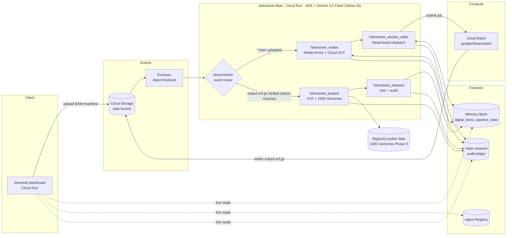

# 🧬 Helixstreet — an autonomous genomic fleet

**All Things Agentic Hackathon · Track: The Fortified Enterprise Fleet**

Raw sequencer output goes into a bucket. An autonomous multi-agent fleet screens it for
compliance, calls variants with **Google DeepVariant** on Cloud Batch, contextualizes them
against the **1000 Genomes** public dataset in BigQuery, and persists a **digital twin** —
with a tamper-evident audit trail — while nobody watches. There is no chat loop anywhere:
the fleet is woken by storage events and works entirely in the background.

## Architecture



**The async centerpiece:** the ingest pipeline dispatches DeepVariant and *ends its turn*.
Minutes later, when the VCF lands in GCS, Eventarc fires again and the analysis pipeline
resumes with full context from the Firestore Memory Bank. The fleet survives arbitrary
gaps between the two halves — the same mechanism would carry week-long jobs.

## The fleet (Agent Registry)

| Agent | Pipeline | What it does | Key tools |
|---|---|---|---|
| `helixstreet_intake` | ingest | Screens uploads with Model Armor, de-identifies manifests with **Cloud DLP** | `scrub_pii`, `screen_with_model_armor` |
| `helixstreet_variant_caller` | ingest | Dispatches **DeepVariant** as an async **Cloud Batch** job, checkpoints state | `submit_deepvariant_job` |
| `helixstreet_analyst` | analysis | Parses the VCF, queries **1000 Genomes** in BigQuery for population allele frequencies | `parse_vcf`, `annotate_with_1000genomes` |
| `helixstreet_steward` | analysis | Persists the digital twin, closes the hash-chained audit trail | `save_digital_twin`, `record_audit_event` |

Routing between pipelines is deterministic (Eventarc events → regex router); execution
*within* each stage is agentic — Gemini decides tool order, handles missing manifests,
blocked screens, and degraded services, and writes the audit narrative.

## Enterprise-fleet pillars → implementation

| Pillar | Where |
|---|---|
| Agent Registry | `fleet/registry.py` → Firestore `agent_registry`, rendered in the dashboard |
| Agent Runtime (async, long-running) | Eventarc-driven Cloud Run + Cloud Batch for heavy compute |
| Memory Bank | Firestore `digital_twins` + `pipeline_state` (bridges the async gap) |
| Agent Identity | 3 service accounts, least-privilege IAM (`infra/deploy.sh`) — the analyst can read BigQuery but cannot launch compute; the dashboard can read state but cannot call agents |
| Guardrails | Model Armor prompt screening + Cloud DLP de-identification at intake |
| Telemetry | Structured JSON logs to Cloud Logging + full reasoning trace mirrored to Firestore (live in the dashboard) |
| Provenance | Hash-chained audit ledger; the dashboard re-verifies the chain on every refresh |

## Hackathon requirements

- **Gemini 3.5 Flash via Vertex AI** — `GEMINI_MODEL=gemini-3.5-flash`, `GOOGLE_GENAI_USE_VERTEXAI=TRUE`
- **Google Agent Framework** — [Agent Development Kit (ADK)](https://google.github.io/adk-docs/): `Agent`, `SequentialAgent`, `Runner`
- **Google Cloud infrastructure** — Cloud Run, Cloud Batch, Eventarc, Cloud Storage, Firestore, BigQuery, Cloud DLP, Cloud Logging
- **Google AI models** — Gemini 3.5 Flash + **DeepVariant** (Google's deep-learning variant caller)

## Spin-up (one command)

Prereqs: `gcloud` authenticated against a billing-enabled project.

```bash
gcloud config set project YOUR_PROJECT_ID
./infra/deploy.sh
```

The script is idempotent and does everything: enables APIs, creates Firestore + the data
bucket, creates the three service accounts with least-privilege IAM, deploys both Cloud Run
services from source, wires the Eventarc trigger, and stages the public reference genome.

### Run the demo

Either click **Start demo run** in the dashboard sidebar, or:

```bash
./scripts/run_demo.sh my-first-sample
```

This stages a synthetic patient manifest (with fake PII, so you can watch DLP redact it)
plus the public **NA12878** chr20 quickstart slice. Then watch, hands off:

1. **Pipeline runs** tab — intake scrubs PII, variant caller dispatches Cloud Batch (live reasoning trace)
2. [Batch console](https://console.cloud.google.com/batch/jobs) — DeepVariant runs (~2–5 min on 4 vCPUs)
3. The VCF lands → the fleet wakes itself → **Digital twins** tab fills in
4. **Audit ledger** tab — the hash chain verifies end-to-end

Cost: the demo slice (chr20:10,000,000–10,010,000) costs cents; everything fits far inside
the $150 credit grant. Nothing needs to stay running between demos — redeploy anytime with
the same script.

### Local development

```bash
cd helixstreet-agent
python3.11 -m venv .venv && source .venv/bin/activate
pip install -r requirements.txt
export GOOGLE_GENAI_USE_VERTEXAI=TRUE GOOGLE_CLOUD_PROJECT=... DATA_BUCKET=...
uvicorn main:app --port 8080          # POST GCS-style events to /eventarc
```

```bash
cd helixstreet-ui
pip install -r requirements.txt
streamlit run dashboard.py
```

## Data & compliance

Only public, consented reference data is used (NA12878 / Genome in a Bottle via the
DeepVariant quickstart; 1000 Genomes Phase 3 via BigQuery public datasets). The "patient"
manifest is synthetic and exists to demonstrate DLP redaction. Outputs are framed as
research-grade annotations, never medical diagnoses.

## Repo layout

```
helixstreet-agent/     Fleet service (FastAPI + ADK), Cloud Run
  main.py              Eventarc router + idempotency
  fleet/agents.py      The four agents / two pipelines
  fleet/tools/         DLP, Model Armor, DeepVariant/Batch, VCF, BigQuery, memory, audit
helixstreet-ui/        Streamlit fleet command center, Cloud Run
infra/deploy.sh        One-shot idempotent GCP deployment (APIs, IAM, services, trigger)
scripts/               Demo trigger + test-data staging
```
